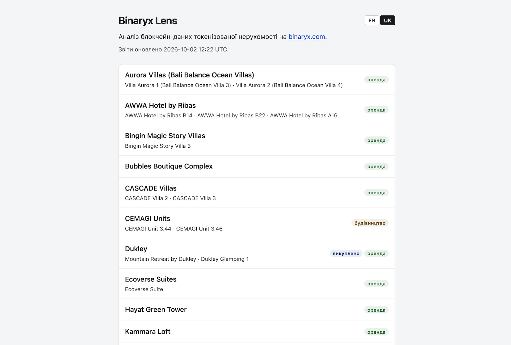
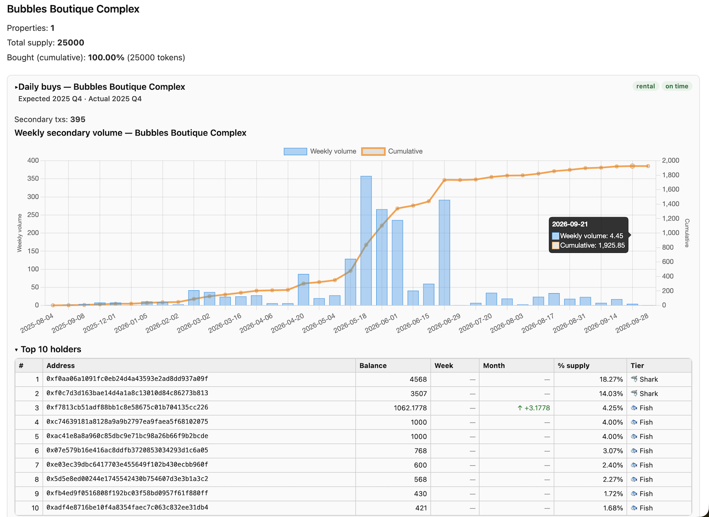
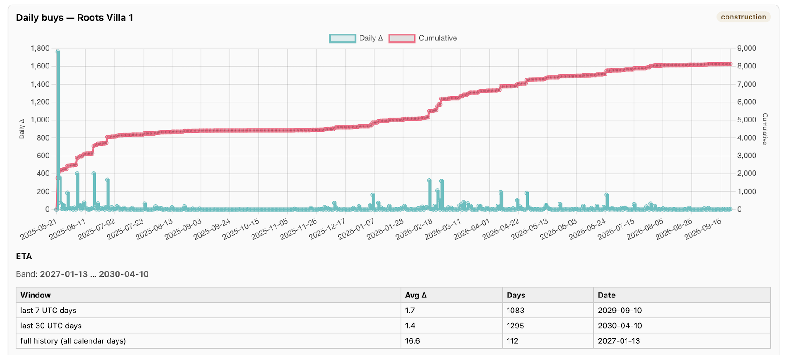
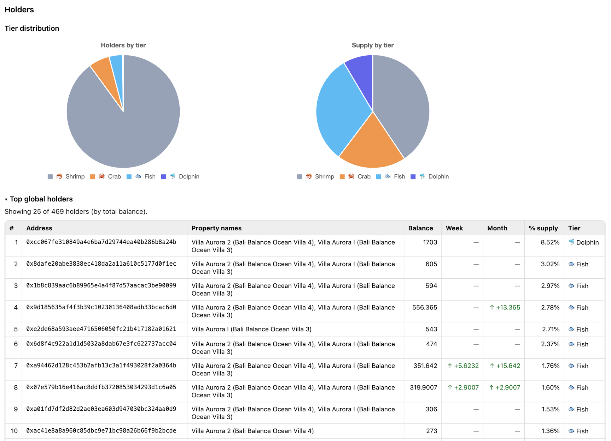

# Binaryx Lens

On-chain analytics for tokenized real estate on [binaryx.com](https://binaryx.com).

**Live reports:** https://aint.github.io/binaryxlens/

## Why

Binaryx sells fractional shares of rental and development properties as ERC-20 tokens on Polygon. The platform shows marketing numbers. Binaryx Lens reads token transfers, marketplace fills, and posted rent from the chain and shows what is happening: how fast each property sells, who holds it, what they paid, and whether rental income starts on time.

## What it shows

The index lists every project, with search and filters for construction, rental, and redeemed. Each project is a static report page:

- **Summary** — properties, total supply, tokens bought.
- **Price** — area, Binaryx list price, USDT raised on the initial sale (on-chain), market USD/m² band, and an estimated value tier (underpriced, fair, rich, overpriced). Market ranges and the tier are estimates and can be wrong.
- **Rental status** — expected vs actual start quarter. On time, one quarter late, or later.
- **Posted rent** — monthly USDT from on-chain rent windows, plus **net rental yield** (annualized profit vs raised USDT) over the last 12, 6, 3, or 1 months of history, with the window shown. Claims and wallet pushes are not included.
- **Initial sales** — weekly buys and the cumulative curve, with drag-to-zoom.
- **Sell-out ETA** — projected completion from the last week, the last four weeks, and full history. A sold-out property shows the sale period and average buy rate instead.
- **Secondary market** — weekly wallet-to-wallet volume, cumulative volume, and transaction count.
- **Holders** — balance, initial-sale and P2P tokens and USDT, week and month changes, entry and exit dates. Exited holders are listed separately.
- **Tier distribution** — holders grouped by share of supply: 🦐 shrimp ≤0.5%, 🦀 crab ≤1%, 🐟 fish ≤5%, 🐬 dolphin ≤10%, 🦈 shark ≤20%, 🐋 whale >20%.

Reports are available in English and Ukrainian.

`go run .` writes `index.html` and `reports/*.html`. A daily GitHub Action regenerates those files at 00:00 UTC. The property catalog is `internal/properties.go`.

## Screenshots

<!-- TODO: add screenshots to docs/screenshots/ -->

| Index | Project report |
| --- | --- |
|  |  |

| Initial sales & ETA | Holders & tiers |
| --- | --- |
|  |  |

## Run locally

```bash
go run .
```

Local runs use a built-in Etherscan API v2 fallback when no key is set. Override with `POLYGONSCAN_API_KEY` or `-api-key` (Polygon, chain id 137). Prefer env or flag in shared clones so the fallback is not relied on.

Flags:

- `-api-key` — Etherscan API v2 key (overrides `POLYGONSCAN_API_KEY`).
- `-scan-pause` — extra pause between token-transfer pages (default `400ms`). The client also spaces every call.

Open `index.html` in a browser.

## Disclaimer

Not affiliated with Binaryx. Data comes from public blockchain records and the Binaryx website. Not financial advice.
